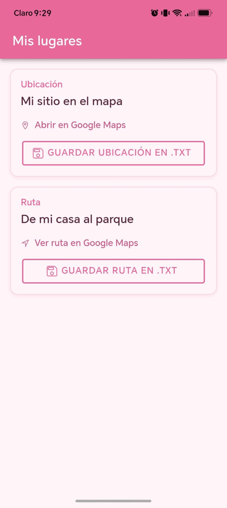
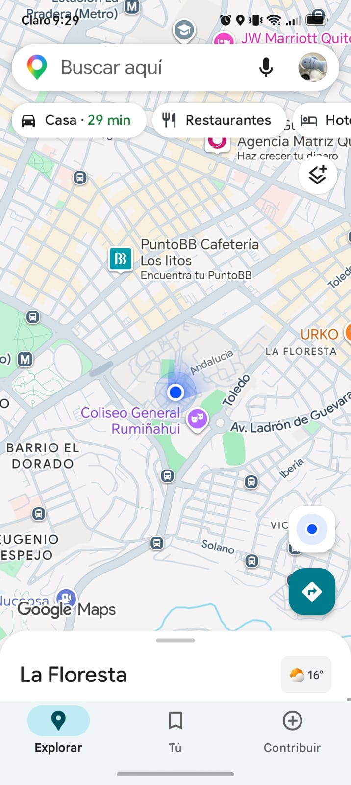
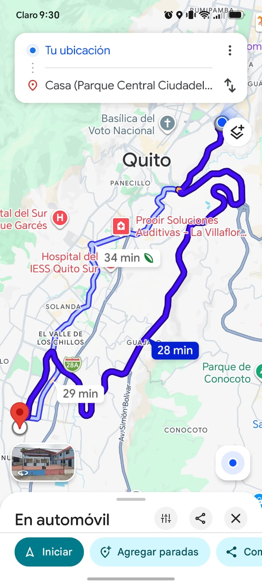
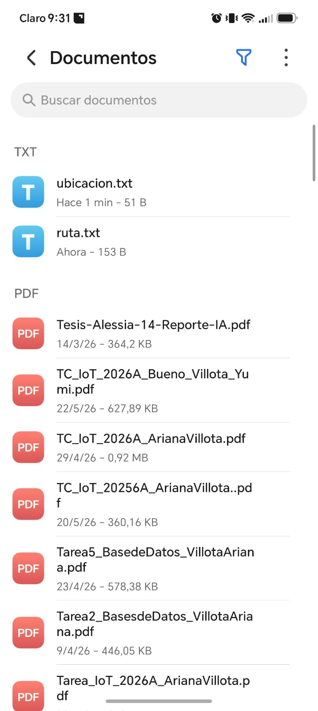
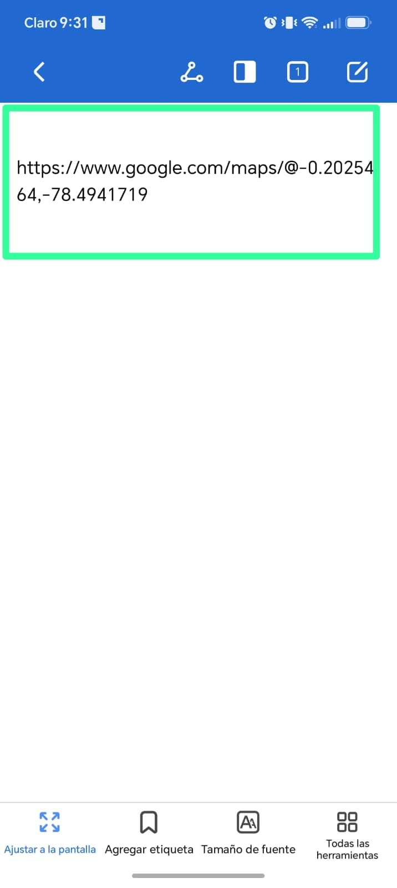

# GPS y Rutas

Aplicación móvil desarrollada con Ionic y Angular que abre ubicaciones y rutas en Google Maps y guarda los enlaces en archivos de texto dentro del teléfono.


| **Autora** | Ariana Elizabeth Villota Jácome |

---

## Funcionalidades

1. Hipervínculo que abre la posición GPS de mi sitio en Google Maps.
2. Hipervínculo que muestra la ruta de mi casa a la universidad, con paradas intermedias.
3. Botón que guarda la ubicación en el archivo `ubicacion.txt`.
4. Botón que guarda la ruta en el archivo `ruta.txt`.

## Tecnologías

| Herramienta | Uso |
|---|---|
| Ionic 8 + Angular (standalone) | Interfaz y lógica de la app |
| Capacitor | Puente entre la app web y Android |
| `@capacitor/filesystem` | Escritura de los archivos `.txt` |
| Android Studio | Compilación y ejecución en el celular |

---

## Capturas de pantalla

| Inicio | Mi ubicación actual | Recorrido | Archivo TXT | Comprobación TXT |
|:---:|:---:|:---:|:---:|:---:|
|  |  |  |  |  |

**Inicio.** Pantalla principal con dos tarjetas: ubicación y ruta. Cada una tiene su enlace a Google Maps y su botón de guardado.

**Mi ubicación actual.** Al tocar el enlace de ubicación se abre Google Maps en la posición GPS de mi sitio.

**Recorrido.** Al tocar el enlace de ruta se abre Google Maps con el recorrido de mi casa a la universidad.

**Archivo TXT.** Al presionar los botones, la app crea `ubicacion.txt` y `ruta.txt` y muestra la ruta donde quedaron guardados.

**Comprobación TXT.** Contenido del archivo abierto desde la carpeta Documentos del celular, que confirma que la URL se guardó correctamente.

---

## URLs utilizadas

Ubicación:

```
https://www.google.com/maps/@-0.2025464,-78.4941719
```

Ruta:

```
https://www.google.com/maps/dir/?api=1&origin=-0.180653,-78.467838&destination=-0.229415,-78.524581&waypoints=-0.201452,-78.498124%7C-0.220164,-78.512328
```

---

## Instalación

Requisitos: Node.js, Ionic CLI y Android Studio.

```bash
npm i -g @ionic/cli
git clone <URL-DEL-REPOSITORIO>
cd gps-rutas
npm install
ionic serve
```

## Ejecución en Android

```bash
ionic build
npx cap add android
npx cap sync
npx cap open android
```

Luego, en Android Studio, ejecutar con **Run** en el celular conectado.

## Permisos

En `android/app/src/main/AndroidManifest.xml`:

```xml
<uses-permission android:name="android.permission.READ_EXTERNAL_STORAGE" />
<uses-permission android:name="android.permission.WRITE_EXTERNAL_STORAGE" />
```

Y dentro de la etiqueta `<application>`:

```xml
android:requestLegacyExternalStorage="true"
```

## Estructura principal

```
gps-rutas/
├── capturas/              # imágenes del README
├── src/app/home/
│   ├── home.page.ts       # lógica y guardado de archivos
│   ├── home.page.html     # interfaz
│   └── home.page.scss     # estilos
├── capacitor.config.ts    # ID y nombre de la app
└── README.md
```
